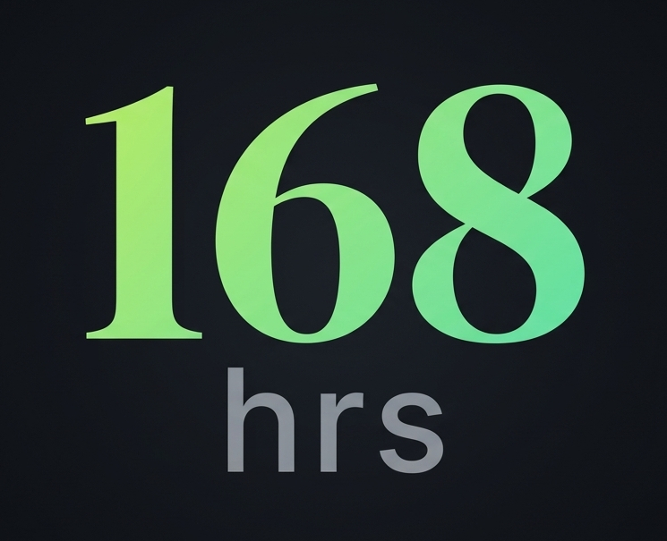

# 168hrs

<p align="center">
  
</p>

<p align="center">
  <strong>Plan your week around the only budget that matters: 168 hours.</strong>
</p>

Local-first time & energy planner for people who want to see the whole week clearly — sleep, deep work, life areas, and the spare capacity that’s left.

---

## The problem

Every week has exactly **168 hours**. Most planning tools track tasks or calendars, but they don’t answer the real questions:

- How much of this week is already claimed by sleep and fixed time?
- How much is planned vs free?
- Am I overloaded before the week even starts?
- Where is my time going across life areas (work, fitness, study, …)?

Without that view, people overcommit, underestimate recovery, and only notice the crunch when it’s too late.

**168hrs** makes the week’s capacity visible: you plan blocks against a finite budget, protect sleep, and see warnings when remaining work eats your spare time.

---

## Features

### Planning
- **Today view** — day’s blocks, live clock (12/24h), planned vs done
- **Week view** — full 168h breakdown; navigate past / current / upcoming weeks
- **Task library** — one-off, recurring, and unscheduled tasks per week
- **Open-ended tasks** — e.g. “3 workouts this week, any day”
- **Unexpected tasks** — log things that appear outside the plan (Today & Week)
- **Focus levels** — deep / medium / light
- **Life areas** — tag work and see them as separate segments on the week bar

### Capacity & sleep
- **Per-night sleep target** (not a vague weekly lump)
- **Bedtime / wake schedule** with first-open-of-day wake log
- **Wasted sleep** — time above your ideal night (default 8h)
- **Spare time** — hours left after planned work
- **Warnings** — low spare (&lt; 3h) and critical overload when work ≥ awake capacity

### Notes
- Optional **Notes** module (toggle in Settings)
- Day-linked notes with optional title & life area
- Pin, edit, delete

### App polish
- **Onboarding** for name & first setup
- **Light / dark** themes
- **First day of week** — any day Sun–Sat
- **Show unscheduled tasks** on Today (optional)
- **Import / export / clear** local data
- Works as a **web app**; Android APK via **Capacitor** + GitHub Actions

---

## Stack

- React 19 + Vite
- react-router-dom
- TanStack Query
- Tailwind CSS 4
- shadcn-style UI primitives
- localStorage (no backend required)

---

## Setup

```bash
npm install
npm run dev
```

Open [http://localhost:5173](http://localhost:5173).

```bash
npm run build    # production build → dist/
npm run preview  # preview production build
npm test         # Vitest
```

Path alias: `@/*` → `src/*`.

---

## Routes

| Path | Page |
|------|------|
| `/` | Today (`?date=` optional) |
| `/week` | Week planner |
| `/tasks` | Current week tasks |
| `/tasks/weeks` | Weeks list |
| `/tasks/:weekId` | Tasks for a week |
| `/notes` | Notes list (if enabled) |
| `/notes/:noteId` | Note editor |
| `/settings` | Preferences |

---

## Project structure

```
src/
├── main.tsx              # BrowserRouter entry
├── App.tsx               # Routes
├── components/           # Layout + UI
├── features/             # Domain (tasks, today, week, notes, settings…)
├── pages/                # Route screens
├── hooks/
└── lib/
public/
└── logo.jpeg             # App logo / favicon source
```

---

## Android (Capacitor)

```bash
npm install @capacitor/core @capacitor/cli @capacitor/android
# ensure vite.config has base: "./"
npm run build
npx cap add android
npx cap sync android
```

CI: see `.github/workflows/android-build.yml` — builds a debug APK on push and attaches it to a GitHub Release.

---

## Data

All data stays in the browser (`localStorage`). Export a JSON backup from **Settings → Data** before clearing or switching devices.

---

## License

[MIT](LICENSE) © 2026 Ahmed Ayman Elgharabawy
